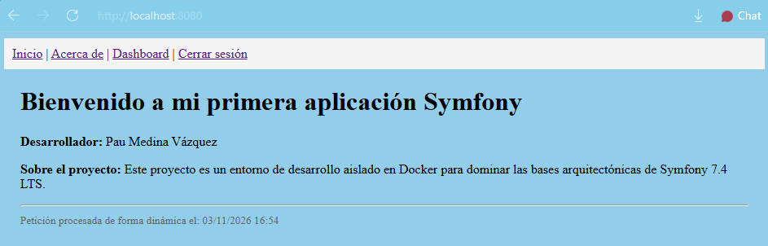

# Fase 2 — Crear y arrancar el proyecto en Docker

> Documento de la práctica de onboarding. Recoge los comandos utilizados, para qué
> sirve cada uno, la URL local y los problemas reales encontrados durante el
> arranque.

## 1. Requisitos previos

En el host solo hacen falta:

- **Docker Desktop** con Docker Compose.
- **Git** para clonar el repositorio.

No es necesario instalar PHP ni Composer en el ordenador: la imagen del contenedor
ya los incluye. La aplicación se ejecuta siempre dentro de Docker.

Comprobación:

```bash
docker --version
docker compose version
git --version
```

## 2. Cómo está montado Docker

### `Dockerfile`

```dockerfile
FROM php:8.4.1-cli
COPY --from=composer:2 /usr/bin/composer /usr/bin/composer
WORKDIR /var/www/html
RUN apt-get update && apt-get install git unzip -y && rm -rf /var/lib/apt/lists/*
```

- Parte de la imagen oficial `php:8.4.1-cli`.
- Copia el ejecutable de Composer desde la imagen oficial `composer:2`.
- Instala `git` y `unzip`, necesarios para que Composer descargue dependencias.
- Define `/var/www/html` como directorio de trabajo.

### `compose.yaml`

```yaml
services:

  web:
    build: .
    container_name: symfony_app
    ports:
      - "8080:8080"
    volumes:
      - .:/var/www/html
    command: php -S 0.0.0.0:8080 -t public/
```

- `build: .` construye la imagen con el `Dockerfile` de este directorio.
- `ports` publica el puerto 8080 del contenedor en el 8080 del host.
- `volumes` monta el código del proyecto dentro del contenedor: los cambios se ven
  sin reconstruir la imagen.
- `command` arranca el servidor integrado de PHP apuntando a `public/`.
- No hay servicio de base de datos: la aplicación usa **SQLite** y el archivo vive
  en `var/`.

## 3. Preparar el secreto local

`APP_SECRET` firma cookies, tokens CSRF y otras estructuras de Symfony. **No puede
estar vacío y no debe subirse a Git**.

El `.env` versionado solo contiene un valor de relleno sin valor secreto. El valor
real se guarda en `.env.local`, que está ignorado por Git.

Generar un valor aleatorio:

```bash
php -r "echo bin2hex(random_bytes(32));"
```

También sirve, si no hay PHP en el host:

```bash
docker run --rm php:8.4-cli php -r "echo bin2hex(random_bytes(32));"
```

Crear `.env.local` en la raíz del proyecto:

```dotenv
APP_SECRET=<valor-generado>
```

> `.env.local` nunca se versiona. Si se filtra un secreto, hay que rotarlo
> (generar otro) además de borrarlo del archivo.

## 4. Primera puesta en marcha

```bash
git clone https://github.com/PauProg/symfony-login.git
cd symfony-login
```

Construir la imagen:

```bash
docker compose build
```

Levantar el contenedor en segundo plano:

```bash
docker compose up -d
```

Instalar las dependencias **dentro del contenedor** (así se usa el PHP y las
extensiones de la imagen, y se respeta `composer.lock`):

```bash
docker compose exec web composer install
```

Comprobar que el contenedor está vivo:

```bash
docker compose ps
```

Abrir en el navegador:

**<http://localhost:8080>**

Deberían verse la página de inicio y, desde la navegación, `/acerca-de`.

## 5. Comandos utilizados y para qué sirven

| Comando | Para qué sirve |
|---|---|
| `docker compose build` | Construye la imagen a partir del `Dockerfile`. |
| `docker compose build --no-cache` | Reconstruye ignorando la caché. |
| `docker compose up -d` | Crea y arranca los contenedores en segundo plano. |
| `docker compose ps` | Muestra el estado de los contenedores. |
| `docker compose logs -f web` | Sigue los logs del contenedor en tiempo real. |
| `docker compose exec web sh` | Abre una shell dentro del contenedor. |
| `docker compose exec web composer install` | Instala dependencias según el lock. |
| `docker compose exec web php bin/console about` | Muestra versión de Symfony, entorno y rutas de trabajo. |
| `docker compose exec web php bin/console debug:router` | Lista las rutas registradas. |
| `docker compose exec web php bin/console cache:clear` | Limpia la caché de Symfony. |
| `docker compose stop` | Detiene los contenedores sin borrarlos. |
| `docker compose up -d` | Vuelve a arrancarlos sin reconstruir. |
| `docker compose down` | Para y elimina contenedores y redes (la imagen se conserva). |
| `docker compose down -v` | Además elimina volúmenes. **Cuidado con datos**. |

## 6. Parar y volver a arrancar sin reconstruir

```bash
docker compose stop
docker compose up -d
```

Con `stop`/`up` no se reconstruye la imagen ni se reinstalan dependencias. Solo hay
que reconstruir (`docker compose build`) cuando cambia el `Dockerfile`.

## 7. Archivos importantes

| Archivo | Qué contiene |
|---|---|
| `composer.json` | Dependencias declaradas, autoload y scripts. |
| `composer.lock` | Versiones exactas instaladas. Se versiona. |
| `vendor/` | Dependencias descargadas. **No se versiona**. |
| `public/index.php` | Front controller: única puerta de entrada HTTP. |
| `.env` | Valores por defecto, sin secretos. Se versiona. |
| `.env.local` | Overrides locales y secretos. **No se versiona**. |
| `.env.test` | Valores del entorno de pruebas. |
| `var/` | Caché, logs y base de datos SQLite. **No se versiona**. |

## 8. Problemas reales encontrados y cómo se resolvieron

### 8.1 Composer no estaba disponible dentro del contenedor

El `compose.yaml` inicial intentaba montar el binario de Composer desde el host:

```yaml
volumes:
  - type: bind
    source: /urs/bin/composer
    target: /usr/bin/composer
```

Ese path tenía dos problemas:

1. Estaba mal escrito (`/urs` en lugar de `/usr`).
2. En Windows/Docker Desktop no existe ese binario en el host, así que el montaje
   no proporcionaba Composer.

**Solución:** eliminar el bind-mount y copiar Composer desde su imagen oficial en
el `Dockerfile`:

```dockerfile
COPY --from=composer:2 /usr/bin/composer /usr/bin/composer
```

### 8.2 Composer fallaba al descargar paquetes

La imagen `php:8.4-cli` no trae `git` ni `unzip`. Composer los necesita para
clonar y descomprimir dependencias.

**Solución:** instalarlos en el `Dockerfile`:

```dockerfile
RUN apt-get update && apt-get install git unzip -y && rm -rf /var/lib/apt/lists/*
```

Después se reconstruye la imagen con `docker compose build`.

### 8.3 Servicios de base de datos que no se usaban

El proyecto generado por las recetas traía un servicio `database` con PostgreSQL y
un `mailer` con Mailpit en `compose.yaml` / `compose.override.yaml`, pero la
aplicación realmente usa SQLite y `MAILER_DSN=null://null`.

**Solución:** eliminar esos servicios y dejar solo el contenedor `web`. En `.env`
se activó SQLite:

```dotenv
DATABASE_URL="sqlite:///%kernel.project_dir%/var/data_%kernel.environment%.db"
```

Así no se levantan contenedores innecesarios y no hay que mantener credenciales de
base de datos.

### 8.4 `APP_SECRET` versionado

El valor de `APP_SECRET` estaba en `.env.dev`, que sí se sube a Git. Eso publica un
secreto en el repositorio.

**Solución aplicada:**

- `.env` contiene solo un valor de relleno sin carácter secreto.
- `.env.dev` ya no contiene secretos.
- El valor real está en `.env.local`, ignorado por Git.
- El valor anterior se ha **rotado**: ya no se usa.

> Como el secreto antiguo sigue en el historial de Git, si el repositorio es
> público conviene purgar el historial (`git filter-repo`) o, al menos, asumir que
> ese valor ya es conocido y no reutilizarlo nunca.

## 9. Evidencia

La aplicación responde en <http://localhost:8080>. Comprobación rápida desde la
terminal:

```bash
curl -I http://localhost:8080
```

Debe devolver `HTTP/1.1 200 OK` (o `200` con el código de estado equivalente).

Captura de la aplicación funcionando:



## 10. Enlaces

- Instalación de Symfony: <https://symfony.com/doc/current/setup.html>
- Configuración y entornos: <https://symfony.com/doc/current/configuration.html>
- Docker Compose: <https://docs.docker.com/compose/>
- Composer CLI: <https://getcomposer.org/doc/03-cli.md>
